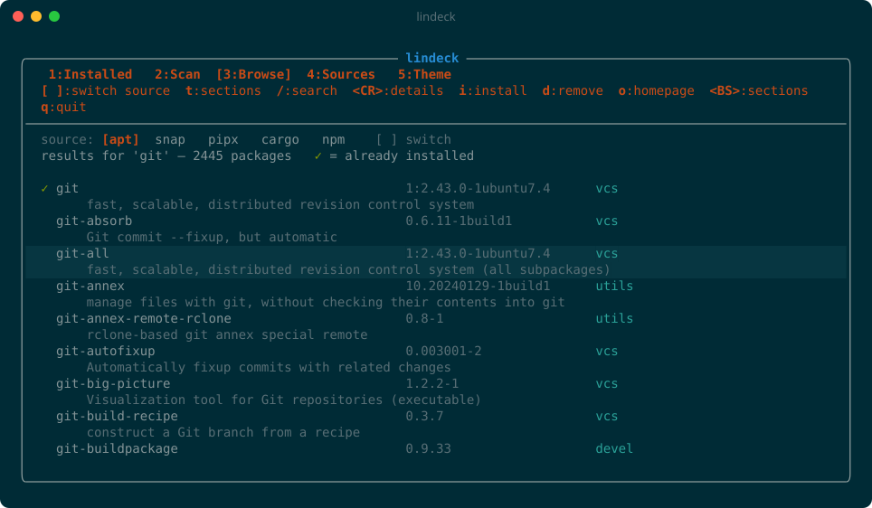
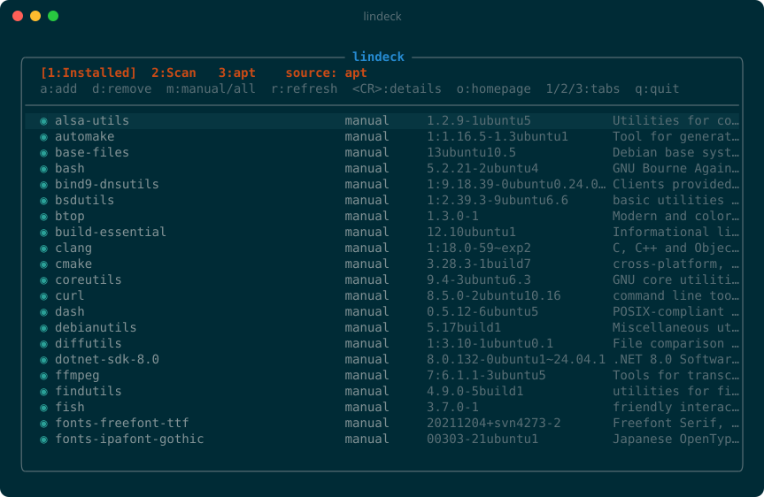
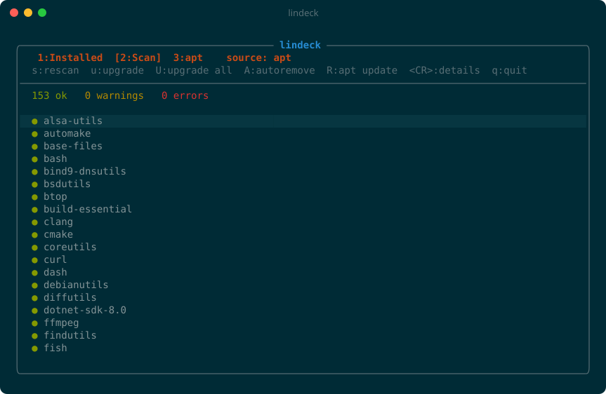
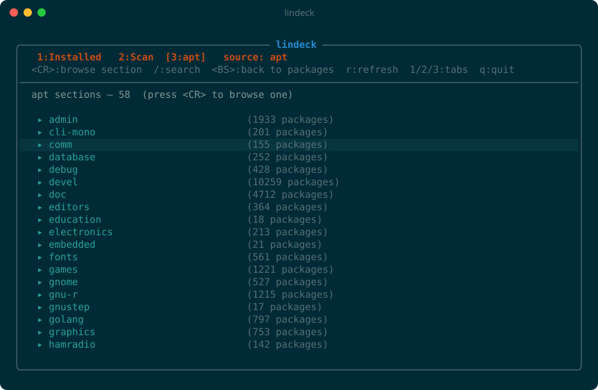
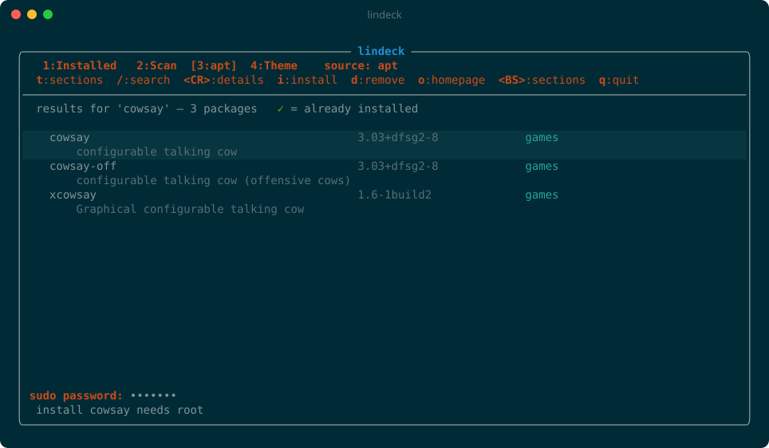
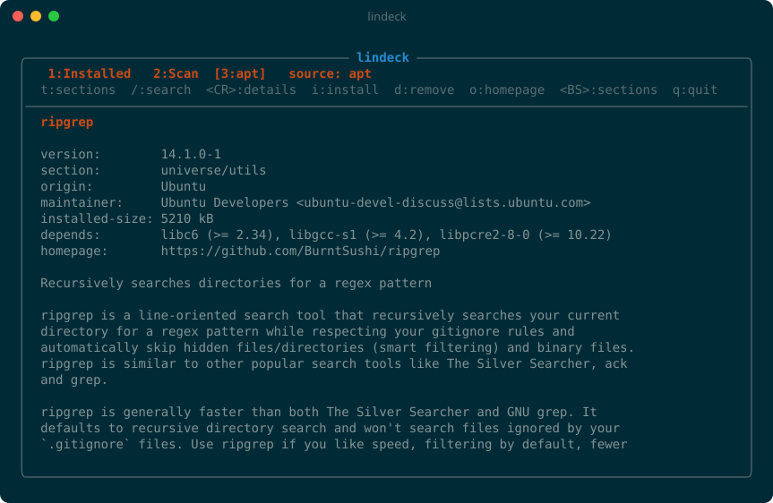
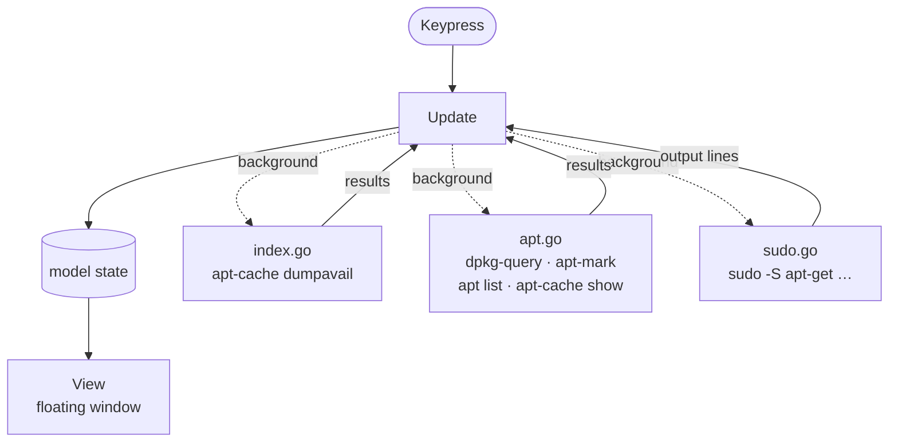

<div align="center">

# 📦 lindeck

**A floating-window TUI package manager for apt — no `sudo` typing required.**

Browse and search the whole apt archive, health-scan your system, and install, remove, or upgrade packages from one keyboard-driven window. Inspired by plugdeck.nvim.

[](go.mod)
[](#prerequisites)
[](#how-it-works)
[](https://github.com/charmbracelet/bubbletea)
[](https://github.com/s501094/lindeck/commits/main)

[Features](#features) ·
[Install](#installation) ·
[Usage](#usage) ·
[Keys](#keybindings) ·
[sudo](#how-sudo-is-handled) ·
[Structure](#project-structure) ·
[Troubleshooting](#troubleshooting)



</div>

---

<a id="features"></a>

## ✨ Features

lindeck has three tabs. Switch between them with <kbd>1</kbd>, <kbd>2</kbd> and <kbd>3</kbd>.

<table>
<tr>
<td width="50%" valign="top">

### 🗂️ 1 · Installed
Packages you installed yourself (`◉ manual`). Press <kbd>m</kbd> to also show packages that came in as dependencies (`◍ auto`). Broken dpkg states show in red as `✗ ERROR`.

<kbd>a</kbd> add · <kbd>d</kbd> remove · <kbd>Enter</kbd> details

</td>
<td width="50%" valign="top">

### 🩺 2 · Scan
A health check with a summary line: **ok** / **warnings** / **errors**. It flags broken installs, pending upgrades, held packages and orphaned dependencies, with errors listed first.

<kbd>u</kbd> upgrade · <kbd>U</kbd> upgrade all · <kbd>A</kbd> autoremove · <kbd>R</kbd> apt update

</td>
</tr>
<tr>
<td width="50%" valign="top">



</td>
<td width="50%" valign="top">



</td>
</tr>
<tr>
<td width="50%" valign="top">

### 🔎 3 · apt browser
Every apt section (admin, devel, editors, games, …) with a package count for each. Open a section, or search names and descriptions. Installed packages are marked with `✓`, and each view remembers where your cursor was.

<kbd>/</kbd> search · <kbd>i</kbd> install · <kbd>o</kbd> homepage · <kbd>Backspace</kbd> back

</td>
<td width="50%" valign="top">

### 🔐 sudo, handled
Any root action opens a masked `sudo password:` prompt (skipped if sudo already has your credentials cached), checks the password, then streams apt's output into a log pane. The password goes straight to sudo and is never stored.

</td>
</tr>
<tr>
<td width="50%" valign="top">



</td>
<td width="50%" valign="top">



</td>
</tr>
</table>

<details>
<summary><b>📄 Package details view</b> — <kbd>Enter</kbd> on any package</summary>
<br>

</details>

### Scan legend

| | Status | Meaning |
|:-:|---|---|
| 🟢 `●` | **ok** | Manually installed and healthy |
| 🟡 `▲` | **warning** | Upgrade available, held back with `apt-mark hold`, or an orphaned dependency that `autoremove` would clean up |
| 🔴 `✗` | **error** | Broken dpkg state, plus a hint to run `sudo dpkg --configure -a` |

---

<a id="prerequisites"></a>

## 🧰 Prerequisites

| Requirement | Notes |
|---|---|
| 🐧 **An apt-based Linux distro** | Debian, Ubuntu, Pop!_OS, Mint, WSL2 Ubuntu, … lindeck calls `apt-get`, `apt-cache`, `apt-mark` and `dpkg-query`. |
| 🔑 **sudo** | Your user must be in the sudoers file (on Ubuntu, the `sudo` group). |
| 🐹 **Go 1.22 or newer** | Only needed to build. The result is a single binary with no runtime dependencies. |
| 🖥️ **A Unicode, 256/truecolor terminal** | For the box drawing, icons and colors. kitty, WezTerm, Alacritty, Windows Terminal and GNOME Terminal all work. |
| 🌐 **`xdg-open` or `wslview`** *(optional)* | Used by <kbd>o</kbd> to open homepages. On WSL, install `wslu` to get `wslview`. |

Check what you have:

```sh
go version          # go1.22 or newer
apt-get --version
sudo -v             # confirms you have sudo rights
```

> [!NOTE]
> lindeck only supports apt today. dnf and pacman backends are on the [roadmap](#roadmap).

---

<a id="installation"></a>

## 📥 Installation

### With `go install`

```sh
go install github.com/s501094/lindeck@latest
```

> [!TIP]
> `go install` puts the binary in `~/go/bin`. If `lindeck` isn't found afterwards, add that directory to your `PATH`:
> ```sh
> export PATH="$HOME/go/bin:$PATH"   # bash / zsh
> fish_add_path ~/go/bin             # fish
> ```

### From source

```sh
git clone https://github.com/s501094/lindeck.git
cd lindeck
go build -o ~/.local/bin/lindeck .
```

`~/.local/bin` is on the `PATH` by default on most distros.

### Uninstall

```sh
rm "$(command -v lindeck)"
```

lindeck doesn't write config files or caches anywhere, so removing the binary removes everything.

---

<a id="usage"></a>

## 🚀 Usage

### TUI

```sh
lindeck              # open on the Installed tab
lindeck ripgrep      # open on the apt tab, already searched for "ripgrep"
```

**A typical install:**

1. Run `lindeck`, press <kbd>/</kbd>, type `htop`, and press <kbd>Enter</kbd>.
2. Move to `htop` with <kbd>j</kbd>/<kbd>k</kbd> and press <kbd>i</kbd>.
3. Type your sudo password at the `sudo password: ••••` prompt and press <kbd>Enter</kbd>.
4. apt's output scrolls in the log pane. When it finishes, the status line shows `✓ install htop done` and `htop` gets its `✓`.

### Command line

```sh
lindeck search ripgrep        # print matches; ✓ marks installed packages
lindeck install htop btop     # install one or more packages
lindeck remove htop           # remove packages
lindeck help                  # usage
```

The `install` and `remove` subcommands run apt directly in your terminal. sudo asks for your password as usual, and apt asks for confirmation before making changes.

---

<a id="keybindings"></a>

## ⌨️ Keybindings

| Key | Action |
|---|---|
| <kbd>1</kbd> <kbd>2</kbd> <kbd>3</kbd> | Switch to the Installed / Scan / apt tab |
| <kbd>j</kbd> / <kbd>k</kbd> (or arrow keys) | Move down / up |
| <kbd>g</kbd> / <kbd>G</kbd> | Jump to the top / bottom |
| <kbd>Ctrl</kbd>+<kbd>d</kbd> / <kbd>Ctrl</kbd>+<kbd>u</kbd> | Half page down / up |
| <kbd>/</kbd> | Search apt |
| <kbd>Enter</kbd> | Details (or open a section) |
| <kbd>o</kbd> | Open the package homepage |
| <kbd>c</kbd> | Clear the output log and status line |
| <kbd>q</kbd> / <kbd>Esc</kbd> | Quit |
| <kbd>Ctrl</kbd>+<kbd>c</kbd> | Quit from anywhere |

<details>
<summary><b>🗂️ Installed tab</b></summary>

| Key | Action |
|---|---|
| <kbd>a</kbd> | Install a package by name |
| <kbd>d</kbd> | Remove the selected package |
| <kbd>m</kbd> | Toggle between your packages only and all packages, including dependencies |
| <kbd>r</kbd> | Reload the installed list |

</details>

<details>
<summary><b>🩺 Scan tab</b></summary>

| Key | Action |
|---|---|
| <kbd>s</kbd> / <kbd>r</kbd> | Rescan |
| <kbd>u</kbd> | Upgrade the selected package |
| <kbd>U</kbd> | Upgrade everything (`apt-get upgrade`) |
| <kbd>A</kbd> | Remove orphaned dependencies (`apt-get autoremove`) |
| <kbd>R</kbd> | Refresh package lists (`apt-get update`), then reload |

</details>

<details>
<summary><b>🔎 apt tab</b></summary>

| Key | Action |
|---|---|
| <kbd>t</kbd> / <kbd>-</kbd> | Show sections |
| <kbd>Backspace</kbd> | Go back to sections, or forward to the last results |
| <kbd>i</kbd> | Install the selected package |
| <kbd>d</kbd> | Remove the selected package |
| <kbd>r</kbd> | Reload the apt index |

</details>

<details>
<summary><b>💬 Prompts</b></summary>

| Key | Action |
|---|---|
| <kbd>Enter</kbd> | Submit |
| <kbd>Esc</kbd> | Cancel |

</details>

---

<a id="how-sudo-is-handled"></a>

## 🔐 How sudo is handled

lindeck runs as your normal user. It never runs as root and never needs to be started with `sudo`. Only the apt command runs as root.


1. When you start an action that needs root, lindeck runs `sudo -n true` to check whether sudo already has your credentials cached. If it does, the action starts right away.
2. If not, lindeck shows a masked `sudo password:` prompt.
3. It checks the password with `sudo -S -k -v` before doing anything. A wrong password shows `incorrect password — try again`, and nothing runs.
4. It then runs the apt command with `sudo -S`, passing the password on sudo's standard input, with `DEBIAN_FRONTEND=noninteractive` so apt never stops to ask a question that the TUI can't answer.
5. Output is streamed line by line into the log pane.

> [!IMPORTANT]
> The password lives in memory only for that one operation. It is never written to disk, logged, or kept for the next action. sudo's own rules apply as usual: failed attempts are logged, and lockout policies such as `faillock` still count.

Each action runs as one specific apt command, which you can see as the first line of the log pane:

| Action | Command run as root |
|---|---|
| Install | `apt-get install -y -o Dpkg::Progress-Fancy=0 -- <pkg>` |
| Remove | `apt-get remove -y -o Dpkg::Progress-Fancy=0 -- <pkg>` |
| Upgrade one | `apt-get install -y ... --only-upgrade -- <pkg>` |
| Upgrade all | `apt-get upgrade -y ...` |
| Autoremove | `apt-get autoremove -y ...` |
| Refresh lists | `apt-get update` |

> [!WARNING]
> Actions run with `-y`, so apt won't ask "Do you want to continue?". Check the package name before pressing <kbd>d</kbd> or <kbd>U</kbd>.

---

<a id="project-structure"></a>

## 🏗️ Project structure

```
lindeck/
├── main.go      Entry point: decides between the TUI and the search / install / remove commands
├── tui.go       The Bubble Tea interface: tabs, rendering, keys, prompts, the log pane
├── index.go     Loads the full apt package index into memory; search and sections
├── apt.go       Installed packages, the health scan, package details, opening homepages
├── sudo.go      Password check and running commands as root with streamed output
├── assets/      Screenshots used in this README
├── go.mod       Module definition and dependencies
└── go.sum
```

| File | What's in it |
|---|---|
| `main.go` | Parses arguments. With no arguments, or with a search term, it opens the TUI. `search`, `install`, `remove` and `help` run without the TUI. |
| `tui.go` | The `model` holds all UI state: current tab, installed list, apt index, scan results, cursor memory per view, the active prompt, the running job and its output. `Update` handles keys and background results, and `View` draws the window. Rows are built only for the items on screen, so a search with tens of thousands of results stays fast. |
| `index.go` | `loadIndex` parses `apt-cache dumpavail` (about 88k packages) into a map and a sorted list, and counts packages per section. `"universe/devel"` and `"devel"` are merged into one section. `Search` ranks matches, and `InSection` lists a section. |
| `apt.go` | `loadInstalled` combines `dpkg-query` (versions, descriptions, dpkg state) with `apt-mark showmanual`. `runScan` builds the health report from dpkg states, `apt list --upgradable`, `apt-mark showhold` and a dry run of `apt-get -s autoremove`. `pkgDetails` formats `apt-cache show` output. `openURL` uses `wslview` or `xdg-open`. |
| `sudo.go` | `sudoCached`, `sudoValidate`, `sudoStream` (runs a root command in the background and sends each output line back to the UI) and `sudoInteractive` (used by the command-line mode). |

**Built with** [Bubble Tea](https://github.com/charmbracelet/bubbletea) (TUI framework), [Bubbles](https://github.com/charmbracelet/bubbles) (text inputs) and [Lip Gloss](https://github.com/charmbracelet/lipgloss) (colors and layout).

---

<a id="how-it-works"></a>

## ⚙️ How it works



- ⚡ **Never freezes.** Everything slow runs in the background: loading the index, reading the installed list, the scan, details, and root commands. Each one reports back to `Update` when it finishes.
- 🧠 **Instant search.** The apt index is loaded once at startup (about a second) and kept in memory, so searching and browsing sections are instant. It reloads after <kbd>R</kbd> (apt update) or <kbd>r</kbd> on the apt tab.
- 🔄 **Always current.** When a root action finishes, the installed list reloads and the scan runs again, so the `✓` markers and the health report stay up to date.

---

<a id="troubleshooting"></a>

## 🩹 Troubleshooting

<details>
<summary><code>lindeck: command not found</code></summary>

The install directory isn't on your `PATH`. See [Installation](#installation).
</details>

<details>
<summary>Search finds nothing, or packages seem missing</summary>

Your package lists are out of date. Press <kbd>R</kbd> on the Scan tab (or run `sudo apt update`), then <kbd>r</kbd> on the apt tab.
</details>

<details>
<summary><code>Could not get lock /var/lib/dpkg/lock-frontend</code> in the log</summary>

Another apt process is running, for example unattended-upgrades or another terminal. Wait for it to finish and try again.
</details>

<details>
<summary><code>incorrect password</code> but the password is right</summary>

Your account may be locked out after earlier failed attempts (`faillock`), or your user isn't in sudoers. Run `sudo -v` in a normal terminal to see the real error.
</details>

<details>
<summary><kbd>o</kbd> doesn't open anything on WSL</summary>

Install `wslu` (`sudo apt install wslu`) so `wslview` is available.
</details>

<details>
<summary>Boxes, icons or colors look wrong</summary>

Use a terminal and font with Unicode support, and make sure `TERM` advertises 256 or truecolor, for example `xterm-256color`.
</details>

<details>
<summary>A package shows <code>✗ ERROR</code></summary>

An install was interrupted. Run `sudo dpkg --configure -a`, then rescan with <kbd>s</kbd>.
</details>

---

<a id="roadmap"></a>

## 🗺️ Roadmap

- [x] apt backend: browse, search, install, remove, upgrade
- [x] Health scan with upgrade / autoremove actions
- [x] In-app sudo prompt with streamed output
- [ ] **No-sudo sources:** GitHub release binaries and AppImages into `~/.local/bin`, plus Flatpak `--user`
- [ ] **More backends:** dnf and pacman, detected automatically
- [ ] **Lockfile and sync:** save your installed set and rebuild it on another machine with `lindeck sync`
- [ ] **Configuration:** window size, colors and icons

---

<a id="contributing"></a>

## 🤝 Contributing

Issues and pull requests are welcome. Before opening a PR:

```sh
gofmt -l .        # should print nothing
go vet ./...
go build ./...
```

Keep UI changes consistent with the existing layout: tab line, key-hint line, divider, then the list.

<div align="center">
<br>
<sub>Made for people who'd rather press <kbd>i</kbd> than type <code>sudo apt install</code>.</sub>
</div>
