<div align="center">

# 📦 lindeck

**One floating-window TUI for apt, Homebrew, Flatpak, Snap, pipx, cargo and npm — no `sudo` typing required.**

Browse and search every package manager on your system, add their repositories, health-scan everything at once, and install, remove, or upgrade from one keyboard-driven window. Missing a package manager? lindeck installs it, or you can plug in your own. Inspired by plugdeck.nvim.

[](go.mod)
[](#prerequisites)
[](#sources)
[](https://github.com/charmbracelet/bubbletea)
[](https://github.com/s501094/lindeck/commits/main)

[Features](#features) ·
[Install](#installation) ·
[Usage](#usage) ·
[Sources](#sources) ·
[Themes](#themes) ·
[Keys](#keybindings) ·
[sudo](#how-sudo-is-handled) ·
[Structure](#project-structure) ·
[Troubleshooting](#troubleshooting)


</div>

---

<a id="features"></a>

## ✨ Features

lindeck has five tabs. Switch between them with <kbd>1</kbd> – <kbd>5</kbd>.

<table>
<tr>
<td width="50%" valign="top">

### 🗂️ 1 · Installed
Everything you've installed, from every source, with a column showing where each came from. <kbd>[</kbd> <kbd>]</kbd> filter to one source, and <kbd>m</kbd> also shows dependencies (`◍`). Broken dpkg states show in red as `✗ ERROR`.

<kbd>a</kbd> add · <kbd>d</kbd> remove · <kbd>Enter</kbd> details

</td>
<td width="50%" valign="top">

### 🩺 2 · Scan
A health check across every source, with a summary line: **ok** / **warnings** / **errors**. It flags broken installs, pending upgrades (apt, Homebrew, Flatpak, Snap, npm), held packages and orphaned dependencies, with errors listed first.

<kbd>u</kbd> upgrade · <kbd>U</kbd> upgrade everything · <kbd>A</kbd> autoremove · <kbd>R</kbd> apt update

</td>
</tr>
<tr>
<td width="50%" valign="top">


</td>
<td width="50%" valign="top">


</td>
</tr>
<tr>
<td width="50%" valign="top">

### 🔎 3 · Browse
Browse or search any source — <kbd>[</kbd> <kbd>]</kbd> switches between them. apt opens on its sections (admin, devel, editors, …); Homebrew and Flatpak list their whole catalog; Snap, cargo, npm and pipx search their registries. Installed packages are marked with `✓`.

<kbd>/</kbd> search · <kbd>i</kbd> install · <kbd>o</kbd> homepage · <kbd>Backspace</kbd> back

</td>
<td width="50%" valign="top">

### 🔐 sudo, handled
Any root action opens a masked `sudo password:` prompt (skipped if sudo already has your credentials cached), checks the password, then streams apt's output into a log pane. The password goes straight to sudo and is never stored.

</td>
</tr>
<tr>
<td width="50%" valign="top">


</td>
<td width="50%" valign="top">


</td>
</tr>
<tr>
<td width="50%" valign="top">

### 📚 4 · Sources
Every package manager lindeck knows, whether it's installed, and its repositories: apt repositories and PPAs, Homebrew taps, Flatpak remotes. Install a missing manager, add or remove repositories, or add a package manager of your own.

<kbd>i</kbd> install manager · <kbd>a</kbd> add repo · <kbd>n</kbd> new source · <kbd>e</kbd> enable/disable

</td>
<td width="50%" valign="top">

### 🎨 5 · Theme
10 built-in themes with live preview, plus your own custom colors. See [Themes](#themes).

</td>
</tr>
<tr>
<td width="50%" valign="top">

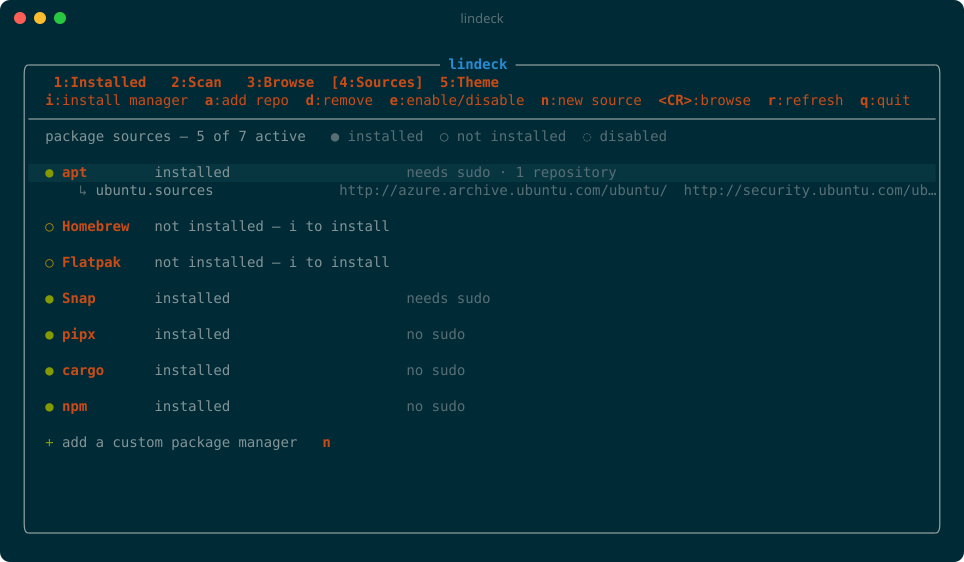

</td>
<td width="50%" valign="top">

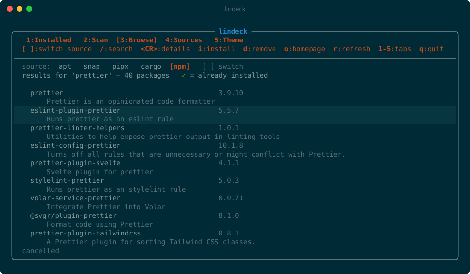

</td>
</tr>
</table>

<details>
<summary><b>📄 Package details view</b> — <kbd>Enter</kbd> on any package</summary>
<br>

</details>

### Scan legend

| | Status | Meaning |
|:-:|---|---|
| 🟢 `●` | **ok** | Manually installed and healthy |
| 🟡 `▲` | **warning** | Upgrade available, held back with `apt-mark hold`, or an orphaned dependency that `autoremove` would clean up |
| 🔴 `✗` | **error** | Broken dpkg state, plus a hint to run `sudo dpkg --configure -a` |

---

<a id="sources"></a>

## 📚 Sources

lindeck works with seven package managers out of the box, and you can add any other. Everything installed is shown together, and every action runs that source's own command, which you can see as the first line of the log pane.

| Source | Browse / search | Needs sudo | Repositories | If it's missing, <kbd>i</kbd> on the Sources tab |
|---|---|:-:|---|---|
| **apt** | whole catalog, by section | yes | repositories & PPAs | — (always on) |
| **Homebrew** | whole catalog | no | taps | runs Homebrew's official installer |
| **Flatpak** | whole catalog, every remote | no (`--user`) | remotes | installs flatpak with apt, adds Flathub |
| **Snap** | Snap Store search | yes | — | installs snapd with apt |
| **pipx** | exact name on PyPI | no | — | installs pipx with apt |
| **cargo** | crates.io search | no | — | runs rustup's official installer |
| **npm** | npm registry search | only if your global prefix isn't yours | — | installs npm with apt |

Sources you don't have are listed as `○ not installed`. Installing one always asks first (`Install Homebrew? (y/N)`), and the log pane shows exactly what runs. Press <kbd>e</kbd> to hide a source you don't want lindeck to touch.

### Adding repositories

Move to a source on the Sources tab and press <kbd>a</kbd>:

| Source | What to type |
|---|---|
| apt | `ppa:neovim-ppa/unstable`, or a full line like `deb [signed-by=/usr/share/keyrings/x.gpg] https://example.com/apt stable main` |
| Homebrew | `user/repo` (a tap on GitHub), or `user/repo https://git.example.com/repo.git` |
| Flatpak | `name https://example.com/repo.flatpakrepo`, or just the `.flatpakrepo` URL |

<kbd>d</kbd> on a repository removes it, after asking. Your distro's own sources (like `ubuntu.sources`) are marked `(system)` and lindeck won't remove them.

### Adding your own package manager

If someone creates a package manager lindeck doesn't know, press <kbd>n</kbd> on the Sources tab and answer a few questions: its name, the command that shows it's installed, and the commands to search, list, install, remove and upgrade. `{query}` stands for the search text and `{pkg}` for the package name; both are safely shell-quoted. It's saved to your config file, where you can also add or edit one by hand:

```json
{
  "sources": [
    {
      "id": "nix",
      "name": "Nix",
      "bin": "nix-env",
      "search": "nix search nixpkgs {query} --json | jq -r 'to_entries[] | .value.pname + \" \" + .value.version + \" \" + .value.description'",
      "list": "nix-env -q",
      "install": "nix-env -iA nixpkgs.{pkg}",
      "remove": "nix-env -e {pkg}",
      "upgrade": "nix-env -u {pkg}"
    }
  ]
}
```

Only `name`, `bin` and `install` are required. `search` and `list` should print one package per line as `name [version] [description…]`. Set `"root": true` if installs need sudo, and `"setup"` to a command that installs the manager itself, so <kbd>i</kbd> can offer it.

---

<a id="themes"></a>

## 🎨 Themes

lindeck ships with **10 themes**, and you can build your own. Press <kbd>5</kbd> to open the Theme tab:

- **Move** over a theme to preview it live across the whole window.
- **<kbd>Enter</kbd>** applies it. Your choice is saved, so it's there next time.
- **Custom:** <kbd>Enter</kbd> on any of the 11 colors below the list to type your own hex value (`#rrggbb` or `#rgb`). Press <kbd>y</kbd> on a theme first to use it as your starting point.

<p align="center">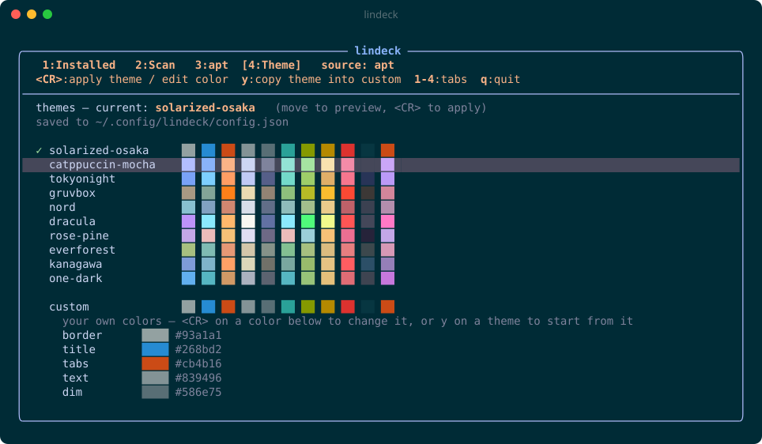</p>

<table>
<tr>
<td align="center">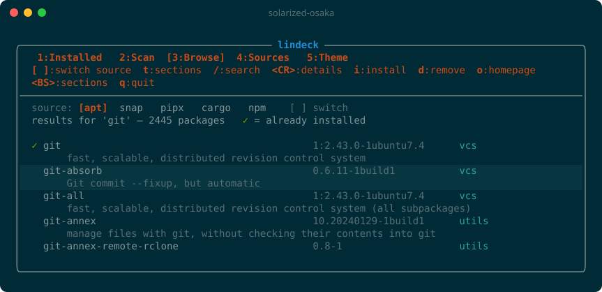<br><b>solarized-osaka</b> <sub>(default)</sub></td>
<td align="center">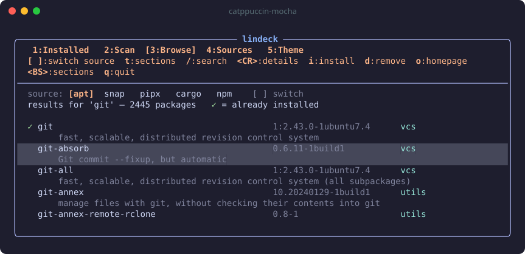<br><b>catppuccin-mocha</b></td>
</tr>
<tr>
<td align="center">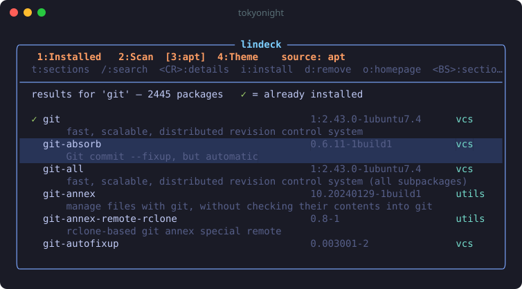<br><b>tokyonight</b></td>
<td align="center">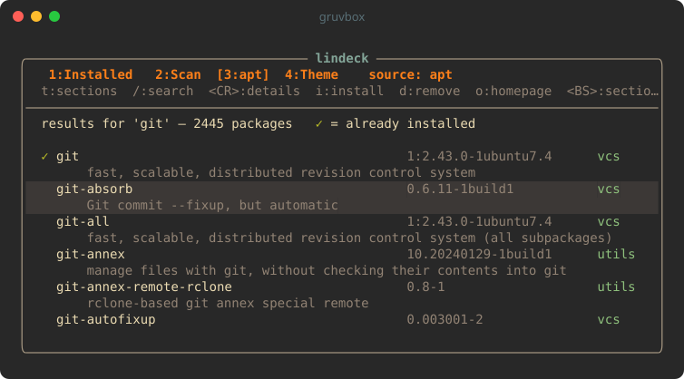<br><b>gruvbox</b></td>
</tr>
<tr>
<td align="center">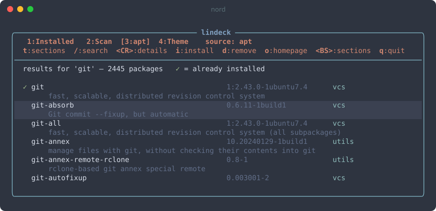<br><b>nord</b></td>
<td align="center">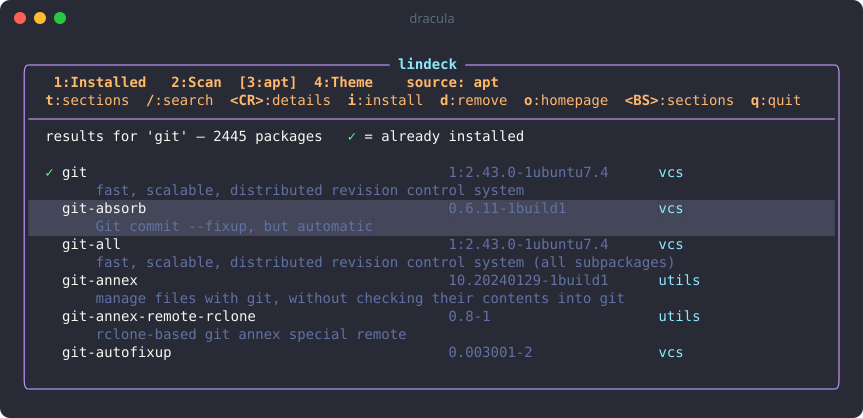<br><b>dracula</b></td>
</tr>
<tr>
<td align="center">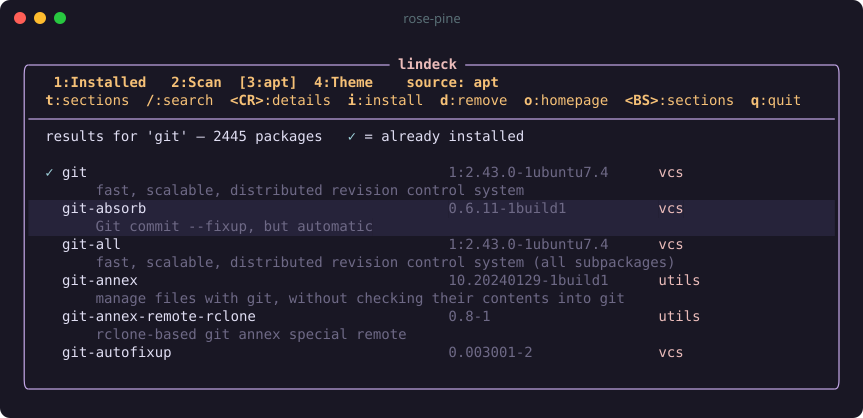<br><b>rose-pine</b></td>
<td align="center">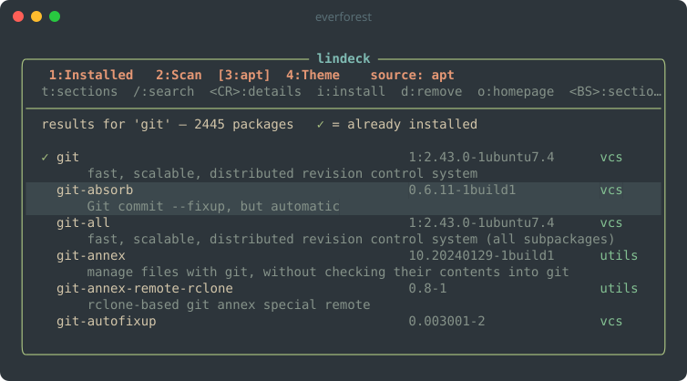<br><b>everforest</b></td>
</tr>
<tr>
<td align="center">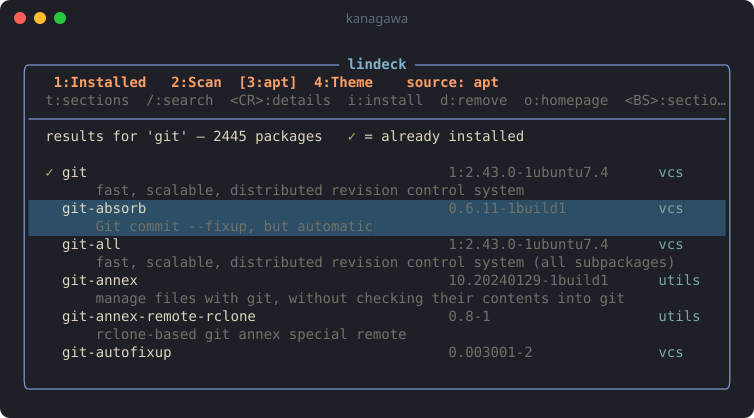<br><b>kanagawa</b></td>
<td align="center">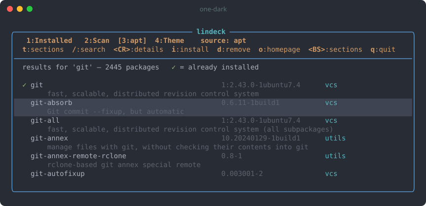<br><b>one-dark</b></td>
</tr>
</table>

> [!TIP]
> lindeck never paints the window background, so it works with transparent terminals and background images. Only the selected row gets a background color.

### Custom colors

| Color | Used for |
|---|---|
| `border` | Window border and divider lines |
| `title` | "lindeck" in the top border |
| `tabs` | Tab line and headings |
| `text` | Normal text |
| `dim` | Key hints, descriptions, versions |
| `accent` | Sections and package icons |
| `ok` | `✓`, `●`, success messages |
| `warn` | `▲`, warnings |
| `error` | `✗`, errors |
| `selection` | Background of the selected row |
| `prompt` | Prompt labels like `sudo password:` |

### The config file

Your choice is saved to `~/.config/lindeck/config.json` (or `$XDG_CONFIG_HOME/lindeck/config.json`). Each user has their own, and you can edit it by hand:

```json
{
  "theme": "custom",
  "custom": {
    "border": "#ff79c6",
    "selection": "#44475a"
  }
}
```

`theme` is one of the 10 theme names above, or `custom`. Any custom color you leave out uses the default theme's color, and an invalid file just falls back to the default theme with a warning.

---

<a id="prerequisites"></a>

## 🧰 Prerequisites

| Requirement | Notes |
|---|---|
| 🐧 **An apt-based Linux distro** | Debian, Ubuntu, Pop!_OS, Mint, WSL2 Ubuntu, … lindeck calls `apt-get`, `apt-cache`, `apt-mark` and `dpkg-query`. |
| 📦 **Other package managers** *(optional)* | Homebrew, Flatpak, Snap, pipx, cargo and npm are picked up automatically if installed — or lindeck can install them for you. |
| 🔑 **sudo** | Your user must be in the sudoers file (on Ubuntu, the `sudo` group). |
| 🐹 **Go 1.22 or newer** | Only needed to build. The result is a single binary with no runtime dependencies. |
| 🖥️ **A Unicode, 256/truecolor terminal** | For the box drawing, icons and colors. kitty, WezTerm, Alacritty, Windows Terminal and GNOME Terminal all work. |
| 🌐 **`xdg-open` or `wslview`** *(optional)* | Used by <kbd>o</kbd> to open homepages. On WSL, install `wslu` to get `wslview`. |

Check what you have:

```sh
go version          # go1.22 or newer
apt-get --version
sudo -v             # confirms you have sudo rights
```

> [!NOTE]
> apt is required because it's the system package manager lindeck builds on. dnf and pacman support is on the [roadmap](#roadmap).

---

<a id="installation"></a>

## 📥 Installation

### With `go install`

```sh
go install github.com/s501094/lindeck@latest
```

> [!TIP]
> `go install` puts the binary in `~/go/bin`. If `lindeck` isn't found afterwards, add that directory to your `PATH`:
> ```sh
> export PATH="$HOME/go/bin:$PATH"   # bash / zsh
> fish_add_path ~/go/bin             # fish
> ```

### From source

```sh
git clone https://github.com/s501094/lindeck.git
cd lindeck
go build -o ~/.local/bin/lindeck .
```

`~/.local/bin` is on the `PATH` by default on most distros.

### Uninstall

```sh
rm "$(command -v lindeck)"
```

To also remove your saved settings (theme, custom sources, disabled sources):

```sh
rm -r ~/.config/lindeck
```

---

<a id="usage"></a>

## 🚀 Usage

### TUI

```sh
lindeck              # open on the Installed tab
lindeck ripgrep      # open on the Browse tab, already searched for "ripgrep" in apt
```

**A typical install:**

1. Run `lindeck`, press <kbd>/</kbd>, type `htop`, and press <kbd>Enter</kbd>.
2. Move to `htop` with <kbd>j</kbd>/<kbd>k</kbd> and press <kbd>i</kbd>.
3. Type your sudo password at the `sudo password: ••••` prompt and press <kbd>Enter</kbd>.
4. apt's output scrolls in the log pane. When it finishes, the status line shows `✓ install htop done` and `htop` gets its `✓`.

To install from somewhere else, press <kbd>]</kbd> on the Browse tab until the source you want is highlighted, then search as usual. Sources that don't need root, like Homebrew or npm, skip the password step.

### Command line

```sh
lindeck search ripgrep        # print matches; ✓ marks installed packages
lindeck install htop btop     # install one or more packages
lindeck remove htop           # remove packages
lindeck help                  # usage
```

The command-line subcommands work with apt. The `install` and `remove` subcommands run apt directly in your terminal. sudo asks for your password as usual, and apt asks for confirmation before making changes.

---

<a id="keybindings"></a>

## ⌨️ Keybindings

| Key | Action |
|---|---|
| <kbd>1</kbd> – <kbd>5</kbd> | Switch to the Installed / Scan / Browse / Sources / Theme tab |
| <kbd>[</kbd> / <kbd>]</kbd> | Previous / next source (Browse), or source filter (Installed) |
| <kbd>j</kbd> / <kbd>k</kbd> (or arrow keys) | Move down / up |
| <kbd>g</kbd> / <kbd>G</kbd> | Jump to the top / bottom |
| <kbd>Ctrl</kbd>+<kbd>d</kbd> / <kbd>Ctrl</kbd>+<kbd>u</kbd> | Half page down / up |
| <kbd>/</kbd> | Search the current source |
| <kbd>Enter</kbd> | Details (or open a section) |
| <kbd>o</kbd> | Open the package homepage |
| <kbd>c</kbd> | Clear the output log and status line |
| <kbd>q</kbd> / <kbd>Esc</kbd> | Quit |
| <kbd>Ctrl</kbd>+<kbd>c</kbd> | Quit from anywhere |

<details>
<summary><b>🗂️ Installed tab</b></summary>

| Key | Action |
|---|---|
| <kbd>a</kbd> | Install a package by exact name, from the source shown on the Browse tab |
| <kbd>d</kbd> | Remove the selected package |
| <kbd>m</kbd> | Also show dependencies (apt's auto packages, snap bases) |
| <kbd>r</kbd> | Reload the installed list |

</details>

<details>
<summary><b>🩺 Scan tab</b></summary>

| Key | Action |
|---|---|
| <kbd>s</kbd> / <kbd>r</kbd> | Rescan |
| <kbd>u</kbd> | Upgrade the selected package |
| <kbd>U</kbd> | Upgrade everything, in every source (root steps first, so one password covers them) |
| <kbd>A</kbd> | Remove orphaned dependencies (`apt-get autoremove`) |
| <kbd>R</kbd> | Refresh package lists (`apt-get update`), then reload |

</details>

<details>
<summary><b>🔎 Browse tab</b></summary>

| Key | Action |
|---|---|
| <kbd>[</kbd> / <kbd>]</kbd> | Switch source |
| <kbd>t</kbd> / <kbd>-</kbd> | Show sections (apt) |
| <kbd>Backspace</kbd> | Go back to sections, or forward to the last results |
| <kbd>i</kbd> | Install the selected package |
| <kbd>d</kbd> | Remove the selected package |
| <kbd>r</kbd> | Reload the catalog, or repeat the search |

</details>

<details>
<summary><b>📚 Sources tab</b></summary>

| Key | Action |
|---|---|
| <kbd>Enter</kbd> | Browse the selected source |
| <kbd>i</kbd> | Install a missing package manager (asks first) |
| <kbd>a</kbd> | Add a repository, tap or remote to the selected source |
| <kbd>d</kbd> | Remove the selected repository, or a custom source |
| <kbd>e</kbd> | Enable / disable the selected source |
| <kbd>n</kbd> | Add your own package manager |
| <kbd>r</kbd> | Reload repositories |

</details>

<details>
<summary><b>🎨 Theme tab</b></summary>

| Key | Action |
|---|---|
| <kbd>j</kbd> / <kbd>k</kbd> | Preview themes as you move |
| <kbd>Enter</kbd> | Apply the theme, or edit the custom color under the cursor |
| <kbd>y</kbd> | Copy the theme under the cursor into custom, to tweak it |

</details>

<details>
<summary><b>💬 Prompts</b></summary>

| Key | Action |
|---|---|
| <kbd>Enter</kbd> | Submit |
| <kbd>Esc</kbd> | Cancel |

</details>

---

<a id="how-sudo-is-handled"></a>

## 🔐 How sudo is handled

lindeck runs as your normal user. It never runs as root and never needs to be started with `sudo`. Only commands that need root run through sudo: apt, Snap, adding apt repositories, and npm when its global prefix isn't yours. Homebrew, Flatpak (`--user`), pipx and cargo don't ask for a password (the one exception is removing a system-wide Flatpak remote).

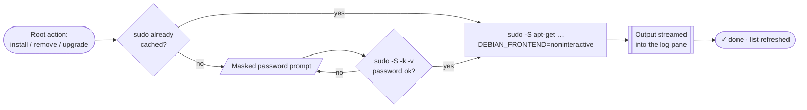

1. When you start an action that needs root, lindeck runs `sudo -n true` to check whether sudo already has your credentials cached. If it does, the action starts right away.
2. If not, lindeck shows a masked `sudo password:` prompt.
3. It checks the password with `sudo -S -k -v` before doing anything. A wrong password shows `incorrect password — try again`, and nothing runs.
4. It then runs the apt command with `sudo -S`, passing the password on sudo's standard input, with `DEBIAN_FRONTEND=noninteractive` so apt never stops to ask a question that the TUI can't answer.
5. Output is streamed line by line into the log pane.

> [!IMPORTANT]
> The password lives in memory only for that one operation. It is never written to disk, logged, or kept for the next action. sudo's own rules apply as usual: failed attempts are logged, and lockout policies such as `faillock` still count.

For apt, each action runs one specific command, which you can see as the first line of the log pane:

| Action | Command run as root |
|---|---|
| Install | `apt-get install -y -o Dpkg::Progress-Fancy=0 -- <pkg>` |
| Remove | `apt-get remove -y -o Dpkg::Progress-Fancy=0 -- <pkg>` |
| Upgrade one | `apt-get install -y ... --only-upgrade -- <pkg>` |
| Upgrade all | `apt-get upgrade -y ...` |
| Autoremove | `apt-get autoremove -y ...` |
| Refresh lists | `apt-get update` |

> [!WARNING]
> Actions run non-interactively (`-y`, `--noninteractive`), so nothing asks "Do you want to continue?". Check the package name before pressing <kbd>d</kbd> or <kbd>U</kbd>.

> [!NOTE]
> Homebrew's installer needs sudo once, to create `/home/linuxbrew`. lindeck asks for your password first so sudo has it cached, then runs the installer as you.

---

<a id="project-structure"></a>

## 🏗️ Project structure

```
lindeck/
├── main.go      Entry point: decides between the TUI and the search / install / remove commands
├── tui.go              The Bubble Tea interface: tabs, rendering, keys, prompts, the log pane
├── tui_sources.go      The Sources tab and the custom-source form
├── tui_theme.go        The Theme tab
├── sources.go          What a source is, and running jobs with streamed output
├── sources_builtin.go  apt, Homebrew, Flatpak, Snap, pipx, cargo and npm
├── sources_custom.go   Package managers you define in config.json
├── index.go            In-memory catalogs: search and sections
├── apt.go              apt's installed list, health scan and package details
├── sudo.go             Password check and the command-line mode's sudo
├── theme.go            The 10 themes, custom colors, and loading / saving config.json
├── assets/             Screenshots used in this README
├── go.mod              Module definition and dependencies
└── go.sum
```

| File | What's in it |
|---|---|
| `main.go` | Parses arguments. With no arguments, or with a search term, it opens the TUI. `search`, `install`, `remove` and `help` run without the TUI. |
| `tui.go` | The `model` holds all UI state: current tab, the sources, installed packages and catalogs per source, scan results, cursor memory per view, the active prompt, the running job and its output. `Update` handles keys and background results, and `View` draws the window. Rows are built only for the items on screen, so a search with tens of thousands of results stays fast. |
| `sources.go` | `Source` describes a package manager as a set of optional functions: catalog, search, installed, outdated, info, install / remove / upgrade, repositories, and setup. `runStream` runs a `job` (through sudo or not) and streams its output; jobs can chain, as in "install flatpak, then add Flathub". |
| `sources_builtin.go` | The seven built-in sources, each mapping lindeck's actions to its tool's real commands and parsing their output. |
| `sources_custom.go` | Turns a `CustomSource` from config.json into a `Source`, filling `{query}` / `{pkg}` into shell commands with safe quoting. |
| `tui_sources.go` | The Sources tab: source and repository rows, its keys, and the step-by-step form for adding a package manager. |
| `index.go` | `newIndex` turns a catalog into a searchable index. For apt, `aptCatalog` parses `apt-cache dumpavail` (about 88k packages) and packages are counted per section. `"universe/devel"` and `"devel"` are merged into one section. `Search` ranks matches, and `InSection` lists a section. |
| `apt.go` | `loadInstalled` combines `dpkg-query` (versions, descriptions, dpkg state) with `apt-mark showmanual`. `runScan` builds the health report from dpkg states, `apt list --upgradable`, `apt-mark showhold` and a dry run of `apt-get -s autoremove`. `pkgDetails` formats `apt-cache show` output. `openURL` uses `wslview` or `xdg-open`. |
| `theme.go` | `Theme` holds the 11 colors. `presets` are the built-in themes. `loadConfig` / `saveConfig` read and write `config.json`, `resolve` fills in missing custom colors, and `applyTheme` rebuilds every style the UI draws with. |
| `sudo.go` | `sudoCached`, `sudoValidate` and `sudoInteractive` (used by the command-line mode). |

**Built with** [Bubble Tea](https://github.com/charmbracelet/bubbletea) (TUI framework), [Bubbles](https://github.com/charmbracelet/bubbles) (text inputs) and [Lip Gloss](https://github.com/charmbracelet/lipgloss) (colors and layout).

---

<a id="how-it-works"></a>

## ⚙️ How it works

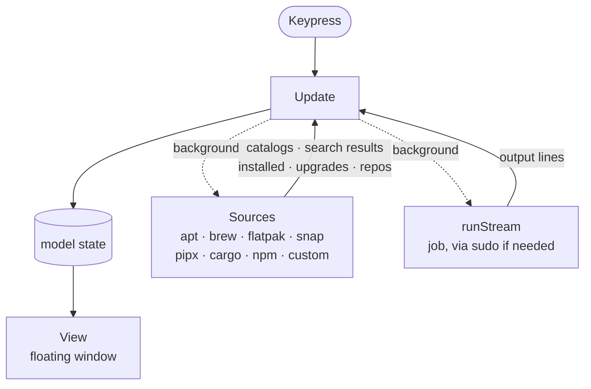

- ⚡ **Never freezes.** Everything slow runs in the background: loading catalogs, reading installed lists, registry searches, the scan, details, and install jobs. Each one reports back to `Update` when it finishes.
- 🧠 **Instant search where possible.** apt, Homebrew and Flatpak catalogs are loaded once and kept in memory, so filtering them is instant. Snap, cargo, npm and pipx are searched online when you press <kbd>Enter</kbd>.
- 🔍 **Detected once.** Each package manager is looked up once at startup, and again after lindeck installs one. (On WSL, searching the Windows directories on your `PATH` for a missing command takes about 200 ms, so lindeck avoids repeating it.)
- 🔄 **Always current.** When a root action finishes, the installed list reloads and the scan runs again, so the `✓` markers and the health report stay up to date.

---

<a id="troubleshooting"></a>

## 🩹 Troubleshooting

<details>
<summary><code>lindeck: command not found</code></summary>

The install directory isn't on your `PATH`. See [Installation](#installation).
</details>

<details>
<summary>Search finds nothing, or packages seem missing</summary>

Your package lists are out of date. Press <kbd>R</kbd> on the Scan tab (or run `sudo apt update`), then <kbd>r</kbd> on the Browse tab.
</details>

<details>
<summary><code>Could not get lock /var/lib/dpkg/lock-frontend</code> in the log</summary>

Another apt process is running, for example unattended-upgrades or another terminal. Wait for it to finish and try again.
</details>

<details>
<summary><code>incorrect password</code> but the password is right</summary>

Your account may be locked out after earlier failed attempts (`faillock`), or your user isn't in sudoers. Run `sudo -v` in a normal terminal to see the real error.
</details>

<details>
<summary><kbd>o</kbd> doesn't open anything on WSL</summary>

Install `wslu` (`sudo apt install wslu`) so `wslview` is available.
</details>

<details>
<summary>Boxes, icons or colors look wrong</summary>

Use a terminal and font with Unicode support, and make sure `TERM` advertises 256 or truecolor, for example `xterm-256color`.
</details>

<details>
<summary><code>brew</code> works in lindeck but not in my shell after installing Homebrew</summary>

lindeck finds Homebrew in `/home/linuxbrew/.linuxbrew` even when it isn't on your `PATH`. To use `brew` in your shell too, add this to your shell config, as Homebrew's installer suggests:

```sh
eval "$(/home/linuxbrew/.linuxbrew/bin/brew shellenv)"                  # bash / zsh
/home/linuxbrew/.linuxbrew/bin/brew shellenv | source                   # fish
```
</details>

<details>
<summary>Flatpak apps don't appear in my app menu</summary>

Log out and back in once after installing Flatpak, so your desktop picks up `~/.local/share/flatpak/exports`.
</details>

<details>
<summary>A source shows an error on the Installed tab</summary>

The message comes from that tool. Run the same command yourself (for example `snap list` or `npm ls -g`) to see the full error, then press <kbd>r</kbd>.
</details>

<details>
<summary>A package shows <code>✗ ERROR</code></summary>

An install was interrupted. Run `sudo dpkg --configure -a`, then rescan with <kbd>s</kbd>.
</details>

---

<a id="roadmap"></a>

## 🗺️ Roadmap

- [x] apt backend: browse, search, install, remove, upgrade
- [x] Health scan with upgrade / autoremove actions
- [x] In-app sudo prompt with streamed output
- [x] 10 themes plus custom colors, saved per user
- [x] **More sources:** Homebrew, Flatpak, Snap, pipx, cargo and npm, with repository management
- [x] **Your own sources:** plug in any package manager from config.json or the Sources tab
- [ ] **No-sudo binaries:** GitHub release binaries and AppImages into `~/.local/bin`
- [ ] **More backends:** dnf and pacman, detected automatically
- [ ] **Lockfile and sync:** save your installed set and rebuild it on another machine with `lindeck sync`
- [ ] **More configuration:** window size and icons

---

<a id="contributing"></a>

## 🤝 Contributing

Issues and pull requests are welcome. Before opening a PR:

```sh
gofmt -l .        # should print nothing
go vet ./...
go test ./...
go build ./...
```

Keep UI changes consistent with the existing layout: tab line, key-hint line, divider, then the list.

<div align="center">
<br>
<sub>Made for people who'd rather press <kbd>i</kbd> than type <code>sudo apt install</code>.</sub>
</div>
